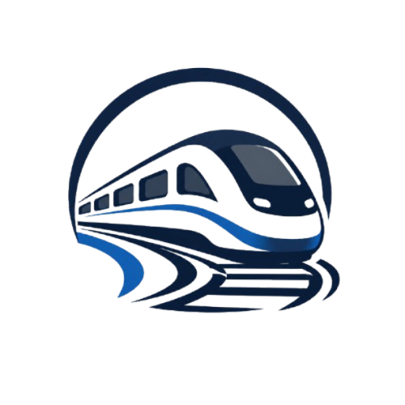

# Track Flow



Sistema web para gerenciamento e monitoramento de operações ferroviárias. O Track Flow reúne informações sobre trens, linhas ferroviárias, sensores e usuários em uma única plataforma, com o objetivo de facilitar a organização, a consulta e o acompanhamento das informações relacionadas à frota ferroviária.

## Integrantes

- Tiago Neumann
- Murilo Valduga
- Lucas Sombrio
- Guilherme Manske

## Objetivo do projeto

O Track Flow foi desenvolvido com a proposta de oferecer uma plataforma para gerenciamento e monitoramento de informações relacionadas ao transporte ferroviário.

O sistema permite organizar os dados da frota, acompanhar informações dos sensores e administrar os usuários cadastrados. Por meio de uma interface centralizada, busca facilitar a consulta das informações operacionais e contribuir para uma melhor organização dos dados ferroviários.

A aplicação também possui diferentes áreas de acesso, incluindo funcionalidades de autenticação, gerenciamento de registros e visualização de informações.

## Funcionalidades

- **Autenticação:** cadastro de contas, login e encerramento de sessão, com controle de acesso às páginas restritas.
- **Dashboard:** painel principal para apresentação de informações gerais e indicadores relacionados à operação ferroviária.
- **Gerenciamento de trens:** consulta, cadastro, edição e exclusão de trens, com informações como prefixo, modelo, ano de fabricação, status operacional, linha associada e imagem.
- **Gerenciamento de linhas:** organização das linhas ferroviárias cadastradas no sistema e associação dos trens às respectivas linhas.
- **Gerenciamento de sensores:** consulta e gerenciamento dos sensores cadastrados, incluindo informações de identificação, localização e trem associado.
- **Dados dos sensores:** armazenamento e consulta dos registros de leitura relacionados aos sensores.
- **Gerenciamento de usuários:** consulta, cadastro, edição e exclusão de contas, incluindo a possibilidade de definir o tipo de usuário.
- **Interface administrativa:** organização das funcionalidades de gerenciamento por meio de páginas próprias e componentes reutilizáveis.

> **Observação sobre os dados:** o sistema organiza informações armazenadas no banco de dados MySQL. A existência de registros de sensores no banco não significa, por si só, que a aplicação esteja conectada a dispositivos físicos ou recebendo leituras em tempo real.

## Tipos de acesso

O banco de dados prevê dois tipos de usuários, definidos pelo campo `tipo_usuario`:

- **Usuário:** perfil padrão, destinado ao acesso às funcionalidades disponibilizadas para usuários comuns.
- **Administrador:** perfil administrativo, destinado ao gerenciamento de informações e contas cadastradas.

O controle de acesso é realizado por meio de sessões PHP e mecanismos de autorização utilizados nas páginas e operações restritas.

## Tecnologias utilizadas

### Backend

- **PHP:** processamento das páginas, formulários, autenticação e operações realizadas no sistema.
- **MySQL:** armazenamento e organização das informações da aplicação.
- **MySQLi:** comunicação entre o PHP e o banco de dados.
- **Sessões PHP:** controle da autenticação e manutenção dos dados do usuário durante a navegação.

### Frontend

- **HTML5:** estruturação das páginas e dos elementos da interface.
- **CSS3:** estilização, organização visual e responsividade das páginas.
- **JavaScript:** manipulação de elementos, interações e carregamento dinâmico de conteúdos.
- **Font Awesome:** biblioteca de ícones utilizada nos elementos visuais da aplicação.

### Ambiente de desenvolvimento

- **XAMPP:** ambiente local utilizado para executar o Apache, PHP e MySQL.
- **Git e GitHub:** versionamento e armazenamento do código-fonte do projeto.

## Estrutura do repositório

```text
projeto_ferrorama_sa/
│
├── assets/
│   ├── css/
│   │   ├── global.css
│   │   └── style.css
│   │
│   ├── js/
│   │   ├── global.js
│   │   └── dados.js
│   │
│   ├── php/
│   │   ├── conexao.php
│   │   ├── autorizacao.php
│   │   └── arquivos de processamento
│   │
│   ├── html/
│   │   └── estruturas reutilizáveis
│   │
│   └── img/
│       └── imagens e logotipos
│
├── pages/
│   ├── tela_inicio/
│   ├── tela_login/
│   ├── tela_cadastro/
│   ├── tela_dashboard/
│   ├── tela_relatorios/
│   ├── tela_sensores/
│   ├── tela_trens/
│   └── tela_usuarios/
│
├── plano_implementacao.md
│
└── README.md
```

*Observação: a estrutura acima apresenta a organização principal do projeto. Alguns diretórios possuem outros arquivos PHP, CSS e JavaScript específicos para cada funcionalidade.*

## Banco de dados

O projeto utiliza o banco de dados MySQL `trackflow_sa`, responsável por armazenar as informações utilizadas pela aplicação.

Entre as principais tabelas estão:

| Tabela | Finalidade |
|---|---|
| `usuario` | Armazena as contas, credenciais e tipos de acesso dos usuários. |
| `linha` | Armazena as linhas ferroviárias cadastradas. |
| `trem` | Guarda as informações dos trens, incluindo prefixo, modelo, ano, status e imagem. |
| `sensor` | Armazena os sensores cadastrados, suas localizações e os trens associados. |
| `dados` | Registra as informações e leituras relacionadas aos sensores. |

As tabelas possuem relacionamentos por meio de chaves primárias e estrangeiras, permitindo associar os trens às linhas ferroviárias e os sensores aos respectivos trens.

## Como executar o projeto localmente

### Requisitos

- XAMPP ou ambiente equivalente com Apache, PHP e MySQL.
- PHP com a extensão MySQLi habilitada.
- MySQL ou MariaDB.
- Navegador atualizado.

### 1. Baixar o projeto

Clone o repositório ou faça o download dos arquivos pelo GitHub.

```bash
git clone https://github.com/Tiagoneumann/projeto_ferrorama_sa.git
```

Coloque a pasta do projeto dentro do diretório `htdocs` do XAMPP.

Exemplo:

```text
C:\xampp\htdocs\projeto_ferrorama_sa
```

### 2. Iniciar o ambiente

Abra o painel de controle do XAMPP e inicie os serviços:

1. Apache.
2. MySQL.

### 3. Criar o banco de dados

Acesse o phpMyAdmin pelo navegador:

```text
http://localhost/phpmyadmin
```

Crie um banco de dados com o nome:

```sql
CREATE DATABASE trackflow_sa
CHARACTER SET utf8mb4
COLLATE utf8mb4_unicode_ci;
```

Em seguida, crie as tabelas necessárias conforme a estrutura SQL utilizada pelo projeto.

### 4. Configurar a conexão

Abra o arquivo `assets/php/conexao.php` e confira os dados de conexão com o MySQL.

Exemplo de configuração:

```php
<?php

$servidor = "localhost";
$usuario = "root";
$senha = "";
$banco = "trackflow_sa";

$conexao = new mysqli(
    $servidor,
    $usuario,
    $senha,
    $banco
);

if ($conexao->connect_error) {
    die("Erro na conexão: " . $conexao->connect_error);
}

$conexao->set_charset("utf8mb4");

?>
```

Altere os valores caso as configurações locais do MySQL sejam diferentes.

### 5. Acessar a aplicação

Com os serviços Apache e MySQL em execução, abra o navegador e acesse:

```text
http://localhost/projeto_ferrorama_sa/pages/tela_inicio/tela_inicio.php
```

A partir da tela inicial, é possível navegar pelas páginas disponíveis e acessar as funcionalidades do sistema conforme o tipo de usuário.

## Organização e funcionamento

O projeto utiliza PHP para realizar o processamento das informações e estabelecer a comunicação com o banco de dados MySQL.

Os arquivos responsáveis pela conexão e pelas operações do sistema ficam organizados em `assets/php/`. A autorização de acesso às páginas restritas é realizada por meio dos mecanismos de autenticação e controle de sessão.

A pasta `assets/css/` concentra os arquivos de estilização, enquanto `assets/js/` reúne os scripts responsáveis pelas interações no navegador e pelo carregamento dinâmico de conteúdos.

As imagens utilizadas pela aplicação ficam armazenadas em `assets/img/`, e os arquivos presentes em `assets/html/` são utilizados para disponibilizar estruturas reutilizáveis na interface.

As páginas principais ficam organizadas dentro da pasta `pages/`, separadas de acordo com suas respectivas funcionalidades.

## Créditos

**Desenvolvimento do projeto:**

Tiago Neumann, Murilo Valduga, Lucas Sombrio e Guilherme Manske.

**Projeto acadêmico:** S.A. Ferrorama.

**Repositório:** https://github.com/Tiagoneumann/projeto_ferrorama_sa